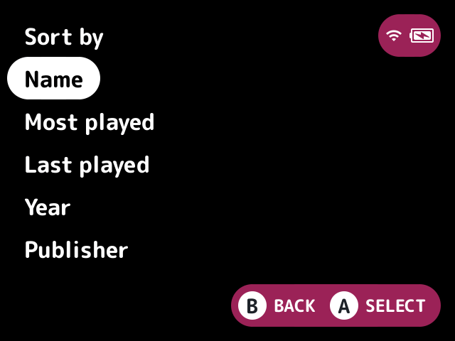
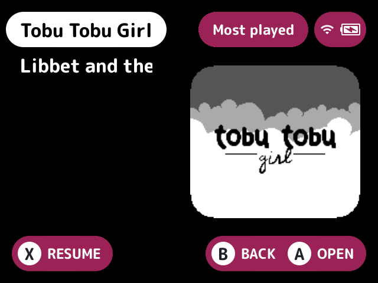
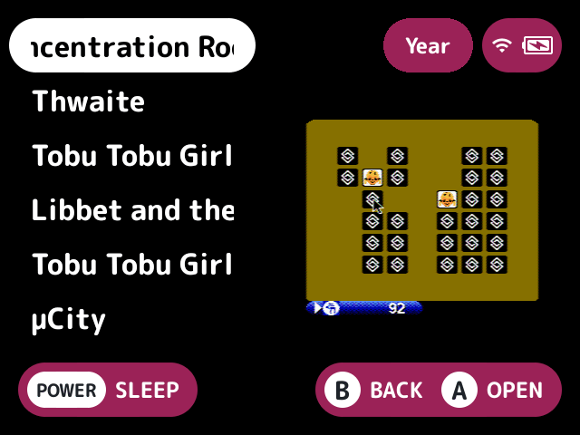
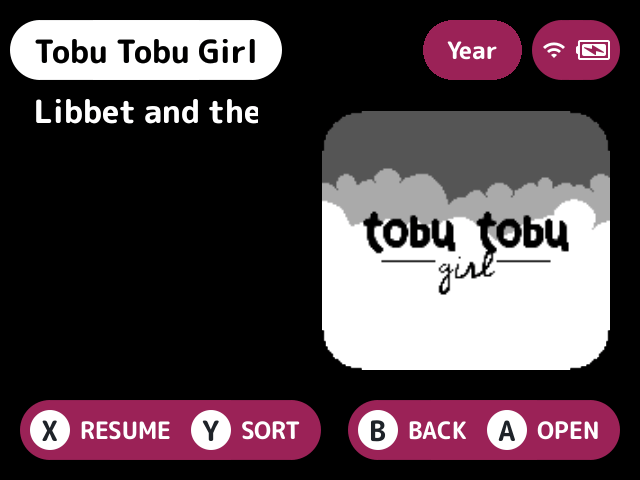
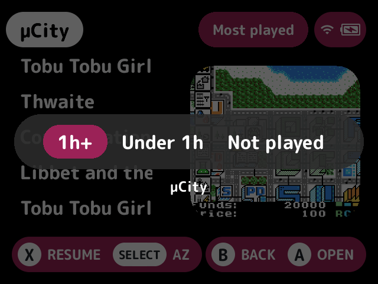

# sort-modes

Sorts every game list, systems and [collections](../../docs/glossary.md#collection) alike, by name, most played, last played, year, publisher or recently added. The header shows the order, and a Sort tile on the [quick menu](../../docs/glossary.md#quick-menu) changes it.

## What it does

- One order for every game list: system folders, folders inside them, collections and plugins' game folders, such as [favorites](../favorites/README.md)' and [tags](../tags/README.md)'. Recently Played, the first screen, the list of systems, the list of collections, [search](../search/README.md)'s results and Tools keep their own order.
- The orders are:
  - Name: the launcher's own order, as without the plugin;
  - Most played: the most time played first, from the play history (the Game Tracker's);
  - Last played: the game played most recently first;
  - Year: the oldest first, from the `year` line of the game's `.info` sidecar file, `<folder>/.media/<name>.info`;
  - Publisher: A to Z, ignoring case, from the `publisher` line;
  - Recently added: the newest file on the card first, by when it was copied there.
- Games with nothing to sort by, such as a game you've never played in Most played or one with no year in Year, go last, by name.
- Games with the same value, such as two from 1991, are by name. Names are the ones the list shows, such as a name from `map.txt`, from [`arcade-names`](../arcade-names/README.md) or with [`numeric-prefix`](../numeric-prefix/README.md)'s number taken off.
- Folders inside a list come first, in the usual order, so they stay easy to find.
- A game folder, holding a `.cue` or `.m3u` named after it, is sorted by its play history like any game. A [`multi-disc`](../multi-disc/README.md) game that hasn't been played through its `.m3u` yet uses its discs': their play time added up, the latest one played, and the newest one added.
- The header shows the order while you're in a list it sorts, such as Year. Name shows nothing.
- [`jump-letter`](../jump-letter/README.md)'s strip and L1 and R1 jump by the order's sections in place of letters: 100h+, 10h+, 1h+ and Under 1h in Most played; Today, Last 7 days, Last 30 days and then each year in Last played and Recently added; each year in Year; each publisher in Publisher; and one more for the games with nothing to sort by, such as No year. Folders keep their letters.
- The order is saved, so it's the same after a restart.

## Turn it on

Turn on **Sort modes** in Launcher > Plugins ([how](../../docs/plugins.md#turning-plugins-on-and-off)).

## How to use

Open the quick menu and pick the Sort tile for a list of the orders, with the current one selected, and pick one. The game you had selected stays selected in its new place.

The Sort button setting puts a button on the game list that steps to the next order, from Name through Recently added and back to Name, shown as SORT in the game list's hints. It's off by default, and used only when no other plugin has an action on that button there. A button steps, rather than opening the list, so a press changes the order at once, and the header and a toast say which one is on. An [FN button](../../docs/glossary.md#fn-button) set to `action:sort-modes.next` steps the same way, and one set to `action:sort-modes.pick` opens the list.

The Sort by setting on the Plugins page sets the order too.

## Screenshots

With the default settings: the Sort tile's list.

Sorted by most played: Game Boy, with Tobu Tobu Girl, the one played, first.

Sorted by year: the Homebrew collection, oldest first, with Tobu Tobu Girl Deluxe and µCity, which have no year, last.

With the Sort button on Y: Game Boy sorted by year, with Y SORT in the hints.

With jump-letter: the Homebrew collection sorted by most played, with SELECT held for the strip of its sections.

## Settings

| Setting | Choices | Default | What it does |
|---|---|---|---|
| Sort by (`mode`) | name, most played, last played, year, publisher, recently added | name | The order of every game list, saved whenever the tile or the button changes it |
| Sort button (`button`) | none, Y, L2, R2, SELECT | none | The game list button that steps to the next order, used only when no other plugin has an action on it there |
| Sort tile on the quick menu (`tile`) | on, off | on | A Sort tile on the quick menu that lists the orders |

## For plugin authors

- Orders lists with `sort_compare`, deciding every pair of games itself, with ties by `entry_name`, and gives each entry its section with `section_key`. In name it has no opinion and gives no sections. Plain folders compare equal to each other, so the plugins after it and the launcher order them.
- Its `plugin.txt` lists `optional=favorites,collections-plus`, so it loads after them and favorites' pinned games and collections-plus' file order keep their place. [`numeric-prefix`](../numeric-prefix/README.md) lists `optional=sort-modes`, so in an order other than name the games aren't put by their numbers first; its numbers still come off the names and still order folders.
- Reads play time and last played from the play history (`play_time` and `last_played`), a game folder's by its `.m3u` or `.cue` when the folder has none, and year and publisher from the card index (`index_find`), which it starts reading in any order but name. Recently added is the later of the file's modified and changed times (`stat`), as [smart-collections](../smart-collections/README.md)' `added:` reads it. For a `.m3u` that isn't on the card yet, it reads the folder's files once for the discs, those with one "(Disc N)", "(CD N)" or "(Disk N)" in their names.
- Works out each game's key once, the first time a sort asks about it, and keeps it by path; during one sort it finds keys by entry, without hashing paths. It forgets them when the order changes, on `launcher.return` and `launcher.profile_changed` in Most played and Last played, and on `launcher.index_ready` in Year and Publisher, listing the folders again with `reload_lists`. Each sorted listing's time is in the log, such as `sorted <folder> by year: 5000 entries, 5000 games, in 9.8 ms`.
- Registers the `sort-modes.next` action, bound with `bind_button` on the first `tick`, once every plugin has loaded, and only to a button no other action has on the game list, as `action_info` lists them; `button` is marked `button:` for it. Registers `sort-modes.pick`, which lists the orders with `choose`, and its quick menu tile.
- Draws a header widget while a list it sorts, with games, is showing, and logs the header's text, and when it's cut to fit.
- Has a `filter` hook that keeps every entry, only to know when a listing starts.
- Saves the order in its own `sort-modes.cfg`. No slots, services, requires or conflicts.

## Credits

ES-DE.
