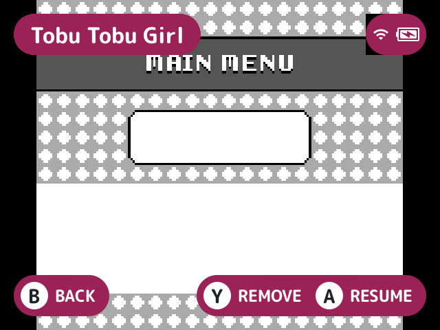
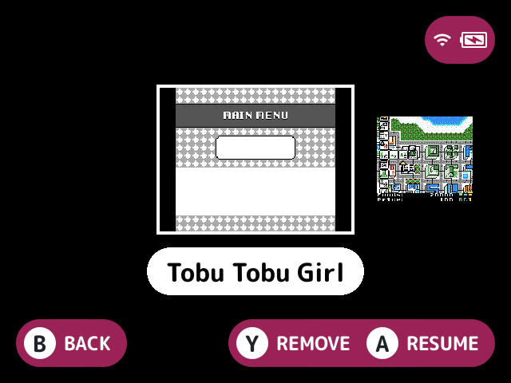
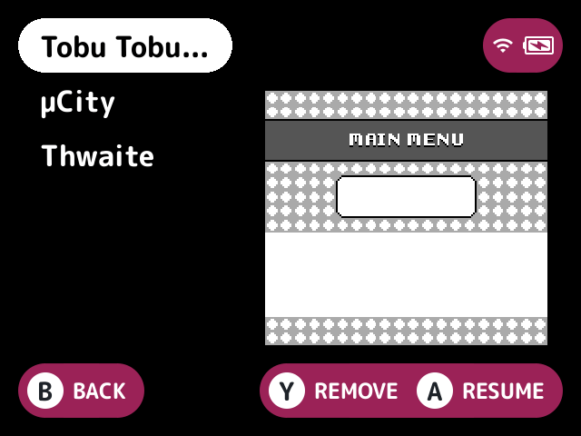
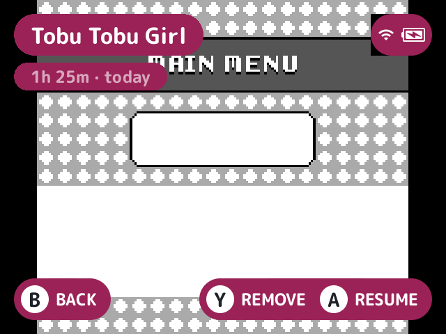

# switcher-plus

Replaces the built-in game switcher with your recent games, in a choice of styles.

## What it does

It shows the recents wherever stock opens the switcher: **SELECT**, an [FN button](../../docs/glossary.md#fn-button), Settings' start screen, and coming back from a game started from it.

Each recent's details are read from the card once each time it opens, and again only when the recents change. Everything is drawn around the status pill and header widgets.

## Turn it on

Turn on **Game switcher plus** in Launcher > Plugins ([how](../../docs/plugins.md#turning-plugins-on-and-off)). It owns the `switcher` [slot](../../docs/glossary.md#slot).

## Styles

| Style | What it looks like | Moving |
|---|---|---|
| `full` (the default) | Stock's look: the selected recent's [save state](../../docs/glossary.md#save-state) preview fitted to the screen, or "No Preview" on the theme's background colour, with its name on a pill in the top left | Left and right step through the recents, wrapping at the ends |
| `strip` | The selected preview large in the middle with its name on a pill under it and smaller previews of its neighbours either side, as many as fit (one either side at 1024 wide) | Left and right step and wrap on a press but stop at an end while held |
| `list` | The recents' names in rows on the left with the selected one on a pill, and its preview in a panel on the right | Up and down step, and left and right go a page |

## How to use

As with stock's switcher:

| Button | What it does |
|---|---|
| **A** | Resumes the selected recent's save state, or opens it when it has none. The launcher comes back to the switcher after the game |
| **Y** | Removes it from the recents, moving to the one before |
| **B**, or a tap of **SELECT** | Goes back to the list (or a plugin's home screen) |

Only presses made while it shows count. The hints are stock's: B BACK, with Y REMOVE and A RESUME, or A OPEN with nothing to resume, or B BACK alone with no recents.

### Captions

With the Play time captions setting on, it adds [`playtime-captions`](../playtime-captions/README.md)' caption for the selected recent, such as "2h 15m · 3 days ago", from the play history with the recent's path. It sits on a smaller pill under the name in `full`, centred under the name pill in `strip`, and centred under the preview in `list`, fitted the same way, compact first and then dropping parts.

Its parts and format are playtime-captions' settings (achievements included), read each time the switcher opens while that plugin is loaded, and its defaults (play time and last played, relative) when it isn't. With no play history, no recent gets a caption. The built-in switcher, with no switcher slot owner, has no captions.

## Screenshots

The game switcher, with the default settings (full style).

Style set to strip.

Style set to list.

With playtime-captions and Play time captions on: the caption under the name.

## Settings

| Setting | Choices | Default | What it does |
|---|---|---|---|
| Style (`style`) | full, strip, list | full | `full` is stock's preview across the screen, `strip` a row of previews, `list` the names beside a preview |
| Play time captions (`captions`) | on, off | off | Each recent's play time captions, in the parts and format playtime-captions' settings pick while it's loaded |

## For plugin authors

- Owns the `switcher` slot (`slots=switcher`).
- Asks the `captions.text` service of `playtime-captions` for captions.

## Credits

Nocturne, nx-redux, MinUI-EX and MinUit.
