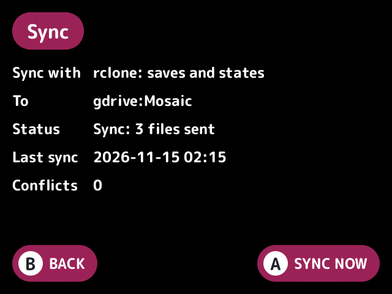
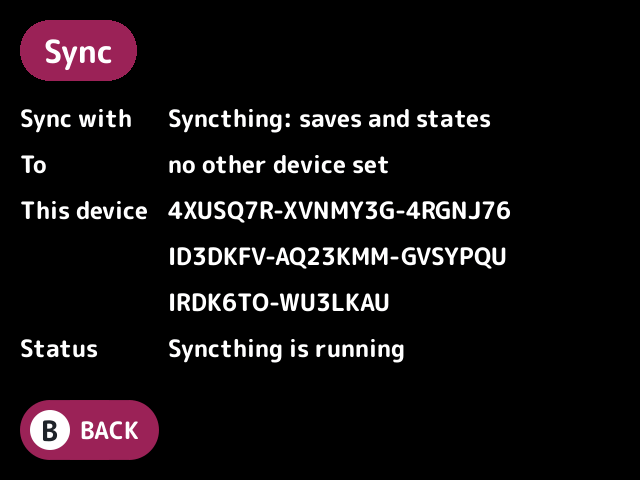

# sync

Keeps your saves and [save states](../../docs/glossary.md#save-state) in step with another place: a cloud drive, a computer, or another handheld. It syncs after each game and when the launcher starts, and the newest copy of a file wins.

It works through one of two programs, which ship with the plugin:

- **rclone**, to any remote rclone reaches, such as Google Drive, Dropbox, OneDrive, an SFTP server or S3, from an `rclone.conf` you make.
- **Syncthing**, with another device running Syncthing, such as a computer or another handheld. Syncthing does the syncing itself while the launcher is up.

## Turn it on

Turn on **Sync** in Launcher > Plugins ([how](../../docs/plugins.md#turning-plugins-on-and-off)), pick a program with **Sync with**, and set that program's settings below.

### rclone

1. On a computer, install rclone and run `rclone config` to add a remote, eg. one called `gdrive`.
2. Copy the `rclone.conf` it made (`rclone config file` says where) to `.userdata/<platform>/launcher/sync/rclone.conf` on the card, or set **rclone config file** to where you put it.
3. Set **rclone remote** to the remote and a folder, eg. `gdrive:Mosaic`. If the config is encrypted, set **rclone config password**.

### Syncthing

1. Install Syncthing on the other device, such as your computer.
2. Set **Syncthing device ID** to that device's ID (in its Syncthing, Actions > Show ID).
3. Leave the launcher up for a moment: on the other device, Syncthing asks to add this device and then to share the **Mosaic saves** and **Mosaic states** folders. Accept them.

This device's own ID is on the Sync screen.

## How to use

Once it's set up with rclone, it works by itself:

- When a game returns, it syncs that game's saves and states.
- When the launcher starts (not when it's back from a game), it syncs everything: what's newer on the other side comes down, and what's newer here goes up.
- A toast says what happened, such as "Sync: 1 file sent". Starting with nothing to do, it says nothing.
- A file changed on both sides since the last sync keeps the newer copy, and the other is kept beside it as `<name>.conflict`, on the side it lost on. The Sync screen counts these.
- A file removed from one side since the last sync is removed from the other too, moved to `<name>.deleted` beside where it was, so you can put it back by renaming it. If it changed on the other side since the last sync, that copy is kept and comes back instead. Before the first sync with a remote there's nothing to go by, so nothing is removed, and when one side has no files at all, as when the remote folder was renamed, nothing is removed either: it's filled again.
- With Wi-Fi off or not connected it says so after a game, and syncs everything at the next start. Syncthing waits for the network by itself.

It syncs the files in `Saves/<tag>/` and in each core's state folder, `.userdata/shared/<tag>-<core>/` (as `States/<tag>-<core>/` on the other side), and nothing else on the card. Hidden files, partial downloads and `.conflict` and `.deleted` copies stay where they are.

With Syncthing, it starts Syncthing as the launcher starts and stops it as the launcher quits, asks it to look at the files after a game, and says whether the other device has them. Syncthing does the rest its own way: it keeps the newer of two changed copies too, naming the other `<name>.sync-conflict-<date>-<time>-<device>.<ext>`, and a file removed on one device is removed on the other by Syncthing, with no `.deleted` copy unless you turn on file versioning for the folder in Syncthing.

With [`romm`](../romm/README.md) set up and uploading saves (Upload saves after playing) or states (Upload states after playing), sync leaves those files to it: the saves or states of a game from RomM, and the files romm last uploaded or restored.

The **Sync** tile on the [quick menu](../../docs/glossary.md#quick-menu) opens the Sync screen: the program, where it syncs to, this device's Syncthing ID, how the last sync went and when, and the conflicts so far. **A** syncs everything now (with Syncthing, asks it to look at the files), and **B** goes back.

## Screenshots

The Sync screen, set up with rclone.

The Sync screen with Syncthing, before the other device's ID is set.

## Settings

| Setting | Choices | Default | What it does |
|---|---|---|---|
| Sync with (`backend`) | rclone, syncthing | rclone | The program it syncs with |
| Sync saves (`saves`) | on, off | on | Syncs the Saves folder |
| Sync states (`states`) | on, off | on | Syncs the cores' state folders in `.userdata/shared` |
| rclone remote (`remote`) | text | empty | rclone: the remote and folder, eg. `gdrive:Mosaic`, from `rclone.conf` |
| rclone config file (`rclone_config`) | text | empty | rclone: its config file; empty for `.userdata/<platform>/launcher/sync/rclone.conf` |
| rclone config password (`rclone_pass`) | text | empty | rclone: the password of an encrypted `rclone.conf` |
| Syncthing device ID (`peer`) | text | empty | Syncthing: the other device's ID |
| Syncthing API key (`api_key`) | text | empty | Syncthing: the key for its API on 127.0.0.1, made when it's empty |
| Quick menu tile (`tile`) | on, off | on | A Sync tile on the quick menu |

Every setting but the two toggles and the tile asks for the launcher's PIN when one is set. **rclone config password** and **Syncthing API key** are secret: once set, the Plugins page shows only that they're set.

## For plugin authors

- Registers the `sync.open` action, which opens the Sync screen (`sync.main`), and a quick menu tile.
- Subscribes to `launcher.return` for the game the launcher's back from.
- Calls `romm`'s `romm.synced` service (see [plugin-api.md](../../docs/plugin-api.md#features-added-since-the-first-api)), with no arguments for `server`, `saves` and `states`, with the game's path for `game`, and with each file's path for `synced`. It reads none of romm's files.
- Ships rclone and Syncthing, their projects' own static linux-arm64 builds, in its lib folder, put there by `make sync-tools-device` (`tools/build.sh`), which downloads each at a pinned version, checks it against `tools/SHA256SUMS` and stops on a mismatch. Their licences ship beside them (see `THIRD_PARTY_NOTICES.txt`). On desktop, `make plugins-desktop` links the computer's own `rclone` and `syncthing` in their place, those it has.
- Runs them one at a time on a worker thread of its own, with a small environment of their own (`HOME` is its data folder, `TZ=UTC`), never through a shell, and stops the one running when the launcher quits. A removal goes through `rclone moveto` to `<name>.deleted` on the remote, or a rename on the card. Syncthing runs from launcher start to quit, from that thread (on Linux it goes with it, with `PR_SET_PDEATHSIG`), with its pid in `/tmp/mosaic-sync-syncthing.pid` and its API on `127.0.0.1:8385` with the generated key.
- Reads and writes `Saves/<tag>/*` and `.userdata/shared/<tag>-<core>/*`, and with Syncthing writes `.stignore` in `Saves` and `.userdata/shared` (in the latter, only the cores' folders sync). Keeps in `.userdata/<platform>/launcher/sync/`: `base-<hash>.txt`, what each file was the last time it was in sync on each side, one record for each remote; `pending.txt` while a sync of everything is owed; and Syncthing's config and data in `syncthing/`. Logs to `.userdata/<platform>/logs/sync.txt`, with the programs' own output, and Syncthing's to `syncthing.txt`. It never logs the rclone password or the API key.
- Holds off auto-sleep while an rclone sync runs.
- No slots, requires or conflicts.

## Credits

Knulli, ROCKNIX and nx-redux.
