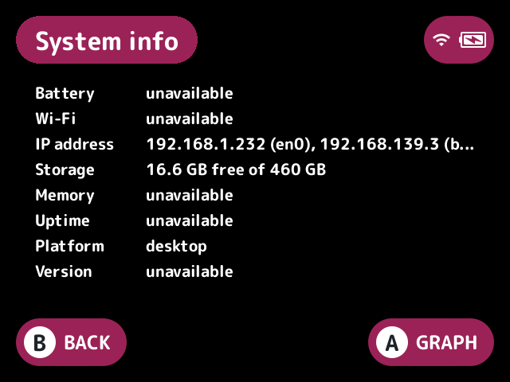
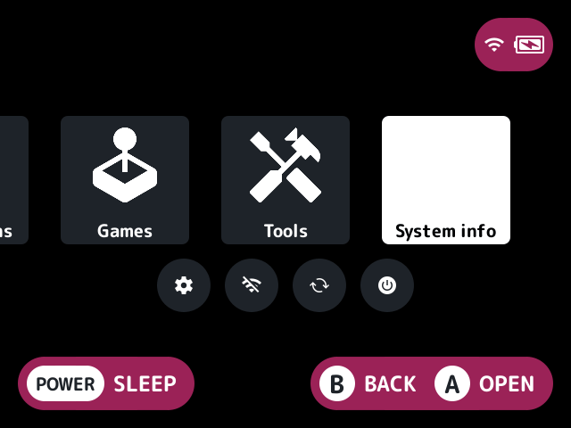

# system-info

Shows the device's state on a read-only screen of its own. It never changes a setting.

## Turn it on

Turn on **System info** in Launcher > Plugins ([how](../../docs/plugins.md#turning-plugins-on-and-off)).

## How to use

Open it from a System info tile on the [quick menu](../../docs/glossary.md#quick-menu), or from a game list button if you set one. The `system-info.open` action opens it too, and [`button-remap`](../button-remap/README.md) or an [FN button](../../docs/glossary.md#fn-button) set to `action:system-info.open` can. **B** closes it.

It shows:

- The battery level and whether it's charging.
- Wi-Fi: the network, its address and signal (such as `Home Net, 192.168.1.50, -65 dBm`), or `off`, `not connected`, or `checking` until the launcher has first looked. It's `unavailable` on a device without Wi-Fi such as desktop.
- The IP addresses: one per interface, IPv4 first, without loopback.
- Free and total storage on the card.
- Free and total memory.
- Uptime.
- The platform, and stock's version from `.system/version.txt`.

A value the platform doesn't have, such as the battery or `/proc` on desktop, shows "unavailable". While it shows, the values are read again once a second and the screen is redrawn only when one changes.

Under the values, a graph shows the battery over the last 64 games [`battery-logger`](../battery-logger/README.md) logged, from `battery-logger.csv` and the `.old.csv` before it, back to back by play time with the time between games left out, or says there's no history yet. When the graph doesn't fit under the values, even at the smaller font, it has a page of its own: **A** moves to it and back, and **B** there goes back to the values.

## Screenshots

The System info screen, with the default settings.

The System info tile on the quick menu (on by default).

## Settings

| Setting | Choices | Default | What it does |
|---|---|---|---|
| Quick menu tile (`tile`) | on, off | on | A System info tile on the quick menu |
| System info button (`button`) | none, Y, L2, R2, SELECT | none | A game list button that opens system info |

## For plugin authors

- Registers the `system-info.open` action, which the `button` setting follows, and a quick menu tile.
- Reads `.system/version.txt`, `/proc`, and `battery-logger.csv` and `battery-logger.old.csv` in `.userdata/<platform>/launcher/`.

## Credits

casualducko and kUI.
