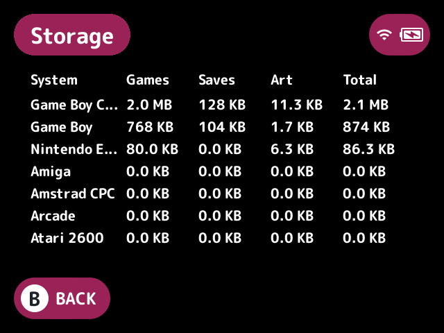
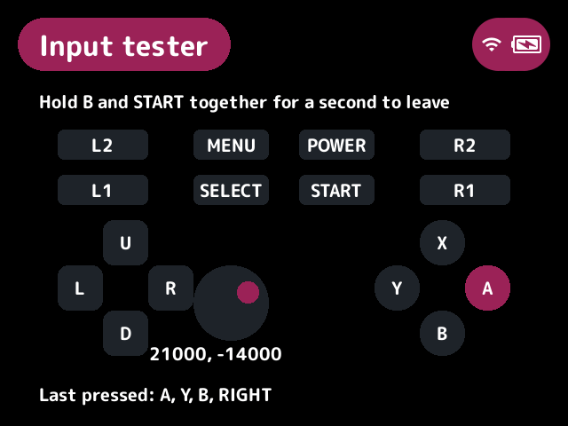

# system-info

Shows the device's state on a read-only screen of its own. It never changes a setting.

## Turn it on

Turn on **System info** in Launcher > Plugins ([how](../../docs/plugins.md#turning-plugins-on-and-off)).

## How to use

Open it from a System info tile on the [quick menu](../../docs/glossary.md#quick-menu), or from a game list button if you set one. The `system-info.open` action opens it too, and [`button-remap`](../button-remap/README.md) or an [FN button](../../docs/glossary.md#fn-button) set to `action:system-info.open` can. **B** closes it, **Y** opens the [Storage page](#storage) and **X** the [input tester](#input-tester).

It shows:

- The battery level and whether it's charging.
- Wi-Fi: the network, its address and signal (such as `Home Net, 192.168.1.50, -65 dBm`), or `off`, `not connected`, or `checking` until the launcher has first looked. It's `unavailable` on a device without Wi-Fi such as desktop.
- The IP addresses: one per interface, IPv4 first, without loopback.
- Free and total storage on the card.
- Free and total memory.
- Uptime.
- The platform, and stock's version from `.system/version.txt`.

A value the platform doesn't have, such as the battery or `/proc` on desktop, shows "unavailable". While it shows, the values are read again once a second and the screen is redrawn only when one changes.

Under the values, a graph shows the battery over the last 64 games [`battery-logger`](../battery-logger/README.md) logged, back to back by play time with the time between games left out, or says there's no history yet, as it does while `battery-logger` is off. When the graph doesn't fit under the values, even at the smaller font, it has a page of its own: **A** moves to it and back, and **B** there goes back to the values.

## Storage

The Storage page lists how much room each system takes on the card, largest first: its games (its folder in `Roms`), its saves and states, under Saves (`Saves/<tag>` and the states in `.userdata/shared/<tag>-<core>`), and its art (the `.media` folders in its `Roms` folder), then `Bios`, `Screenshots` and everything together. A system is named after its `Roms` folder, without its tag, and folders with the same tag, such as `Game Boy (GB)` and `Game Boy Hacks (GB)`, share a row. Saves for a tag with no `Roms` folder get a row named after the tag. **Up** and **down** scroll, and **B** goes back.

It counts the files' sizes as the page first opens, in the background, with a line saying how far it's got, so the page and the rest of the launcher stay responsive on a big card. Links are counted as themselves, never followed, and a file with more than one hard link is counted once. The sizes are kept until a game or [pak](../../docs/glossary.md#pak) has run; the next opening counts again, showing the old sizes until it's done. Opening it from Y or with the `system-info.storage` action are the same.

## Input tester

The input tester draws the device's buttons, which light while they're held: A, B, X and Y, the d-pad, L1, R1, L2, R2, SELECT, START, MENU, POWER and the [FN buttons](../../docs/glossary.md#fn-button) the device has, by its names for them, such as HOME. On a device with sticks, their dots move with them and their raw values show underneath. The last 8 presses are listed at the bottom, newest first.

Every button shows its press and does nothing else while the tester is open, MENU and the FN buttons included, so it's left by holding **B** and **START** together for a second; a bar fills up while they're held. The power button is the exception: it shows its press, but still sleeps and powers off the device as usual. The volume keys, and the brightness with MENU, are stock's and still work, and the launcher's lock chord, when it's on, still locks. Open it with **X** on the System info screen or with the `system-info.input_test` action, such as from an FN button.

## Screenshots

The System info screen, with the default settings.

The System info tile on the quick menu (on by default).

The Storage page, with each system's games, saves and states, and art.

The input tester, with A held and the left stick pushed up and to the right.

## Settings

| Setting | Choices | Default | What it does |
|---|---|---|---|
| Quick menu tile (`tile`) | on, off | on | A System info tile on the quick menu |
| System info button (`button`) | none, Y, L2, R2, SELECT | none | A game list button that opens system info |

## For plugin authors

- Registers the `system-info.open` action, which the `button` setting follows, and a quick menu tile, the `system-info.storage` action for the Storage page, and the `system-info.input_test` action for the input tester. None of them changes anything (no `MOSAIC_ACTION_EDITS`).
- Has three screens: `system-info.main`, `system-info.storage` and `system-info.input`.
- Counts the Storage page on a thread of its own, reading `Roms`, `Saves`, `.userdata/shared`, `Bios` and `Screenshots` on the card, and counts again after `launcher.return`. It never writes to the card.
- While the input tester is on top, its `input_filter` takes every button but the power button, and after it closes the releases of the buttons held as it closed. It reads the sticks with `stick` (see [plugin-api.md](../../docs/plugin-api.md#features-added-since-the-first-api)). Without input filters, on an older launcher, there's no input tester.
- Reads `.system/version.txt` and `/proc`.
- Draws the battery graph from `battery-logger`'s `battery.history` service (see [plugin-api.md](../../docs/plugin-api.md#features-added-since-the-first-api)), asked as the screen opens. Without the service, as with `battery-logger` off, it says there's no battery history; it doesn't read `battery-logger`'s files.

## Credits

casualducko and kUI.
