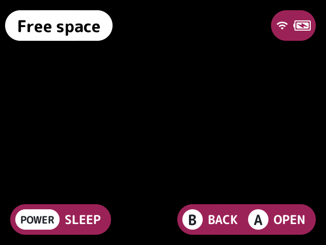
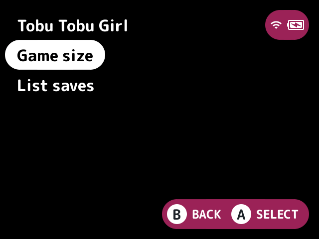
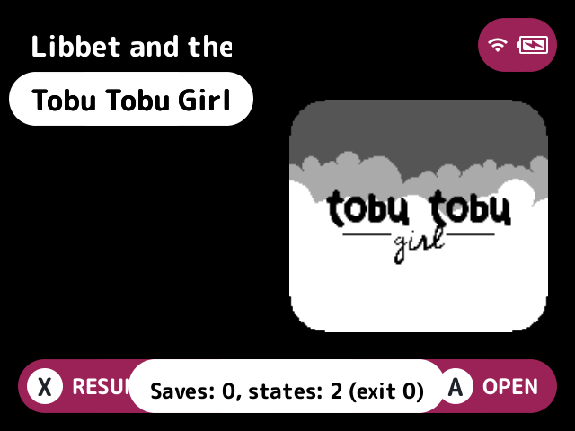
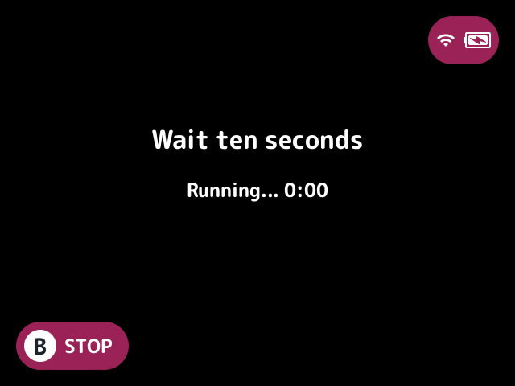

# tasks

Runs shell scripts of your own from a `Tasks` folder on the SD card: some on their own, from a Tasks folder on the first screen, and some for the selected game, from **Y**. When one ends, its last line of output shows as a message with its exit status.

## What it does

- Scripts in `Tasks/` (each a `.sh` file) are listed in a Tasks folder on the first screen, named as their files are without `.sh`. **A** runs one, with no game.
- Scripts in `Tasks/Game/` are on **Y** for the selected game, which they get as `$1`, its full path, such as `/mnt/SDCARD/Roms/Game Boy (GB)/Tetris.gb`. Scripts in `Tasks/Game/<tag>/` are only for the games of the system with that [system tag](../../docs/glossary.md#system-tag), such as `Tasks/Game/GB/` for Game Boy. With other plugins' actions on Y, such as [game-actions](../game-actions/README.md) or [favorites](../favorites/README.md), Y opens a menu of them all.
- A running task shows a wait screen with how long it has run. **B** stops it, with anything it started.
- When it ends, its last line of output shows as a message with its exit status, such as `12.3G free on the SD card (exit 0)`. All of its output is kept in `.userdata/<platform>/logs/tasks/<name>.txt`, from its latest run, with a line saying how it ended. A game task's log is named for its folder too, such as `Game-GB-List saves.txt`.
- When the card has no `Tasks` folder, three example tasks are copied there, which only read:
  - `Free space`: how much space is free on the SD card;
  - `Game/List saves`: the selected game's saves and save states;
  - `Game/Game size`: how much space the selected game takes.

Delete the ones you don't want; they're copied again only when the `Tasks` folder is gone.

## Turn it on

Turn on **Tasks** in Launcher > Plugins ([how](../../docs/plugins.md#turning-plugins-on-and-off)).

## How to use

Open Tasks on the first screen and press **A** on a task, or press **Y** on a game and pick a task. The Tasks folder shows only when `Tasks/` has a task in it.

A task is a shell script run with `/bin/sh`, so it needn't be marked executable, and its `#!` line is ignored. It has no keyboard or screen of its own: what it prints goes to its log, and its last line to the message. It gets these in its environment, with the launcher's own:

| Variable | What it is |
|---|---|
| `SDCARD_PATH` | the SD card, such as `/mnt/SDCARD` |
| `USERDATA_PATH` | this device's `.userdata/<platform>` folder |
| `PLATFORM` | the platform, such as `tg5040` |

For example, `Tasks/Game/Game size.sh`:

```sh
#!/bin/sh
du -sh "$1"
size=$(du -sh "$1" | cut -f1)
echo "$(basename "$1"): $size"
```

Always quote `"$1"`: game names often have spaces, quotes and brackets.

Tasks added to `Tasks/` show in the Tasks folder straight away. Game tasks added to `Tasks/Game/` show on Y the next time the launcher starts, such as after a game.

## Screenshots

With the default settings: the Tasks folder, with the example copied to the card.



Y on a game: the example game tasks.



List saves' last line and exit status, as a message.



The wait screen, while a task runs.



## Settings

None.

## For plugin authors

- Adds a Tasks folder at `<sdcard>/Tasks` to the first screen with `root_entries` and lists its scripts with `virtual_dir`, as paks, and runs a task from its `entry_open` when one is opened, so it never goes through a launch: no paks' `pre-launch.sh` hooks or plugins' `pre_launch` run for it.
- Registers an action with `MOSAIC_ACTION_PATH` for each game task, bound to Y on the game list with `bind_button`: `tasks.game.<name>`, or `tasks.game.<tag>.<name>` for one limited to a system, in lower case with anything but letters, digits and dots as `-`, such as `tasks.game.list-saves`. Each is available only for a game of a system it's for.
- Runs each task as `/bin/sh <script> [<game>]`, the paths as arguments and never through a shell command line, with `posix_spawn` in a process group of its own, with stdin from `/dev/null`, stdout and stderr into its log and none of the launcher's other open files, and with the launcher's environment less `LD_PRELOAD` and `DYLD_INSERT_LIBRARIES`. B sends the group `SIGTERM`, then `SIGKILL` after 2 seconds. A task still running when the launcher quits or powers off, or its wait screen closes some other way, is killed with its group.
- Registers the `tasks.running` screen, its wait screen, and holds off sleep with `inhibit_sleep` while a task runs.
- Reads `Tasks/` and writes the logs in `.userdata/<platform>/logs/tasks/`. Copies `res/tasks/`, its examples, to `Tasks/` when the card has none.
- No requires or conflicts.

## Credits

muOS, Onion and spruceOS.
