# theme-plus

Changes how the launcher looks - colours, font, text size, wallpapers, system icons and button hints - from a theme, without touching stock's settings. It can also show a different theme each start or each day.

A theme is a folder you can copy or share. The launcher's look changes, while stock's Settings app and other apps keep your own palette.

## Turn it on

Turn on **Theme plus** in Launcher > Plugins ([how](../../docs/plugins.md#turning-plugins-on-and-off)), then pick a theme. It owns the `theme` [slot](../../docs/glossary.md#slot).

## How to use

The Theme setting names a theme. The default, `stock`, changes nothing. A theme can be:

- A folder `<sd>/Themes/<name>/` with a `theme.txt` and, if it likes, its own font and wallpapers, and a `sounds/` folder for [`ui-sounds`](../ui-sounds/README.md).
- One of the themes it ships: `nord`, `dracula`, `solarized-dark`, `pocket-green`, `nocturne`, `ember`, `mint` and `high-contrast` (colours only; the last has a 7:1 contrast and larger text).
- The name of any of stock's palettes (the built-in ones and `<sd>/Palettes/*.txt`), as a colours-only theme. It shows only in the launcher while stock's Settings app and other apps keep your palette.

A name is looked for in that order, exactly and then ignoring case.

To pick one from a list, use the Theme tile on the [quick menu](../../docs/glossary.md#quick-menu) or the `theme-plus.pick` action, which the Theme button setting puts on a button. It applies the one picked at once. The list shows the themes by name, then the palettes as stock's Settings lists them, with the one you picked in Settings marked "(in Settings)". A palette with the exact name of a theme or an earlier palette isn't listed, since the name picks that one. Beside the list, a preview shows the theme the cursor is on: its background colour or wallpaper, a selected row and a plain one in its colours, and its seven colours along the bottom. Up and down move by one, left and right by five, A picks and B goes back.

A wallpaper only shows where the card has no stock background (`bg.png`, `.media/bg.png`, `bglist.png` or `quick_<name>.png`), so ones placed by hand win.

### Rotating themes

Set Rotate to `start` for a random theme each time the launcher starts, coming back from a game included, never the same one twice in a row when there's another to pick, or to `daily` for one theme all day, which changes the next day. It picks from every theme the list shows, or only the ones you name in Rotate between, separated by commas, such as `nord, dracula, Night`. While it's on, the Theme setting isn't used; a theme you pick from the list shows until the launcher starts again. A name Rotate between can't find is logged and left out, and with none left the Theme setting's is used.

### System wallpapers and icons

A theme folder can have a wallpaper for each system's list in `wallpapers/<tag>.png` and an icon for each system in `icons/<tag>.png`, both optional. The tag is the one in a system folder's last parentheses, such as `GB` for `Roms/Game Boy (GB)`. The wallpaper shows while the system's folder is selected and inside it, and the icon is the system's art in the list.

Packs work the same way on their own: a folder `<sd>/Wallpapers/<pack>/` of `<tag>.png` wallpapers and `<sd>/Icons/<pack>/` of `<tag>.png` icons, which you pick by name in the Wallpaper pack and Icon pack settings and which mix with any theme, `stock` too. A picked pack's file wins over the theme's own. Stock's own files on the card still win over both: a system's `Roms/.media/<folder>.png`, its folder's `.media/bg.png` or `.media/bglist.png`, and the card's `bg.png`. Like the theme's other files, a pack's must stay inside its folder.

### Text size

The Text size setting makes all of the launcher's text smaller or larger. Above stock's size, the list shows one row fewer, and two button hints in a group that no longer fit their half of the screen go on two rows, one pill above the other, in the room that row leaves. At stock's size or smaller, the rows and hints are as stock has them.

## Writing a theme

A theme is a folder in `<sd>/Themes` with a `theme.txt`, and optionally its font, wallpapers, `wallpapers/` and `icons/` folders of system art (see [System wallpapers and icons](#system-wallpapers-and-icons)) and `sounds/`. A pack is a folder in `<sd>/Wallpapers` or `<sd>/Icons` of `<tag>.png` files, nothing else.

`theme.txt` is lines of `key=value`. Blank lines and `#` comments are skipped.

| Key | Meaning |
|---|---|
| `version` | `1`. A theme with a newer version isn't used |
| `name` | What the list shows, else the folder's name |
| `palette` | A stock palette's name, the first with it in Settings' order, whose seven colours fill the ones the theme leaves unset. The theme's own `color1` to `color7` win |
| `color1` to `color7` | Colours in stock's palette format, `0xRRGGBB` or `0xRRGGBBAA`. `color7` is the background |
| `font` | A TrueType or OpenType file |
| `fallback_font` | A TrueType or OpenType file for the characters the UI font has no glyphs for, such as CJK game names |
| `text_step` | Points added to stock's text, -2 to 8 |
| `contrast` | The least contrast ratio text keeps, 1 to 21, such as `4.5` |
| `pill_size` | 18 to 60 |
| `button_size` | 12 to 56 |
| `padding` | The screen's margins, 1 to 30 |
| `wallpaper`, `wallpaper_list`, `wallpaper_quick` | PNGs for the background, a game folder's background and the quick menu's |
| `hint_style` | `text`, `abxy`, `cardinals` or `shapes`, as stock's Settings names them. The launcher draws button hints in it over your style, in the launcher only. Without it your style stays |

For example, one per line: `name=Night`, `palette=Catppuccin Mocha`, `color7=0x101018`, `font=night.ttf`, `text_step=2` and `wallpaper=bg.png`.

- Font, fallback font and wallpaper paths are relative to the theme's folder and must stay inside it: no absolute paths, no `..`, and no symlink that leads out.
- Any other key with a `.` in it, such as `led-status.colour=0x88C0D0`, is another plugin's. It's passed on to the launcher as it is, for that plugin to read with `theme_value` (see [plugin-api.md](../../docs/plugin-api.md) for the keys the bundled plugins read and the launcher's limits on them), and the launcher logs one it refuses.
- Other unknown keys and lines without `=` are logged and ignored. A bad value is logged and dropped, as is anything the launcher then refuses.
- A `sounds/` folder in the theme's folder holds its sounds for [`ui-sounds`](../ui-sounds/README.md), such as `move.wav` and `select.wav` (its page lists them), which play in place of ui-sounds' own. Like the paths above, it must stay inside the theme's folder.

## Screenshots

The theme picker from the Theme tile, with the default settings.

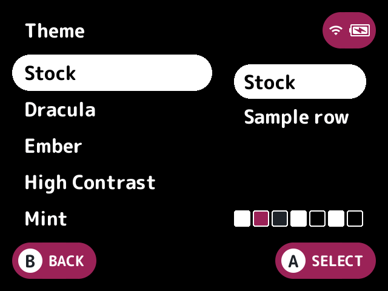

Theme set to nord.

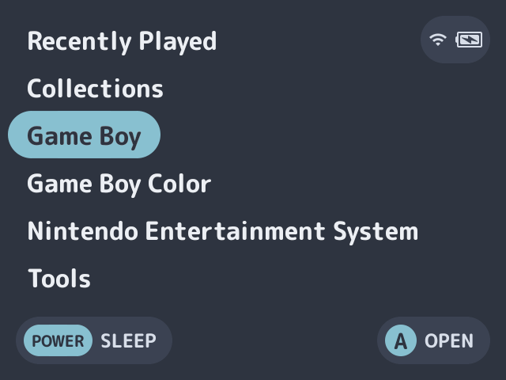

Theme set to dracula.

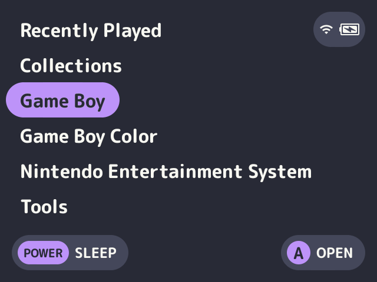

Theme set to solarized-dark.

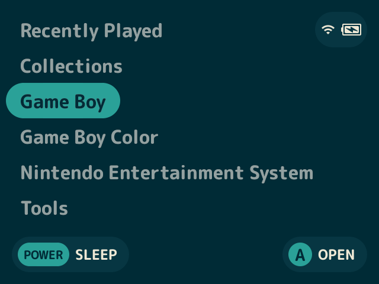

Theme set to pocket-green.

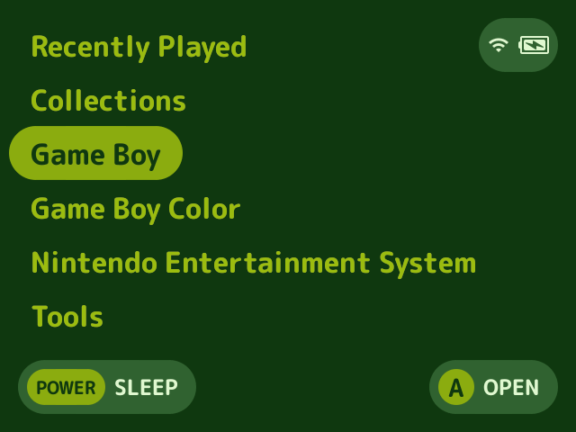

Theme set to nocturne.

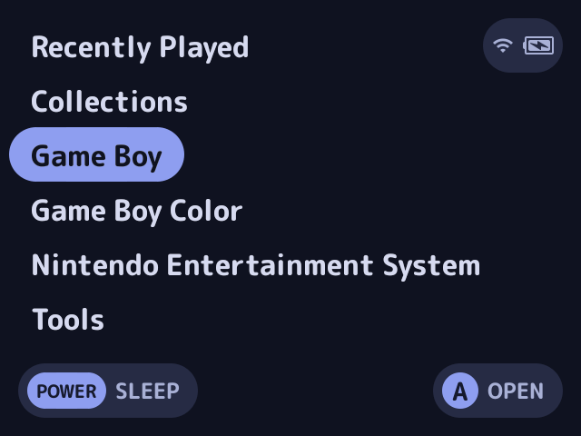

Theme set to ember.

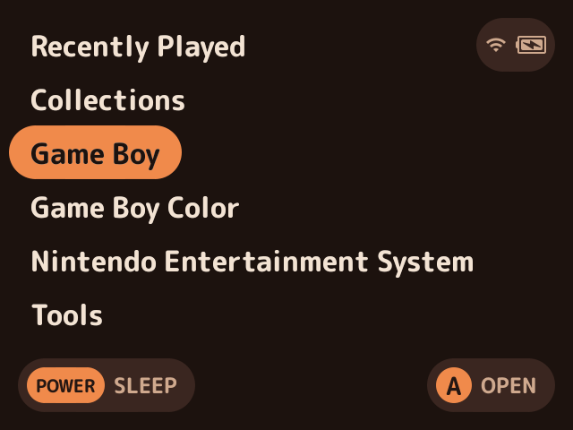

Theme set to mint.

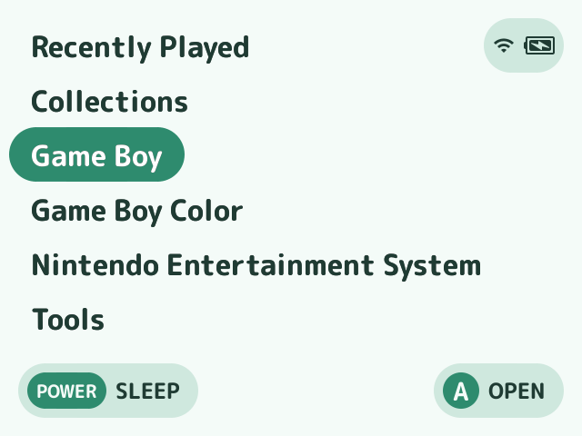

Theme set to high-contrast.

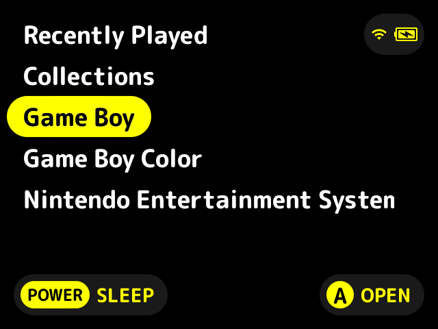

The picker's preview, on a theme with a wallpaper.

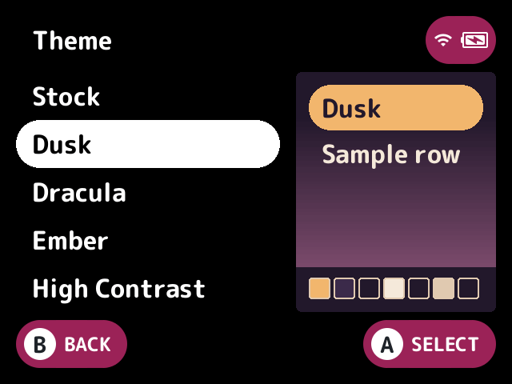

Text size set to larger and Theme button set to Y, with the game list's left hints on two rows.

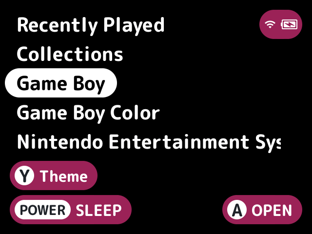

A theme with its own wallpaper for the Game Boy's list.

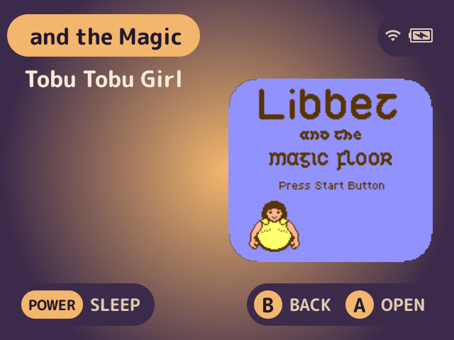

Icon pack set to a pack with an icon for each system.

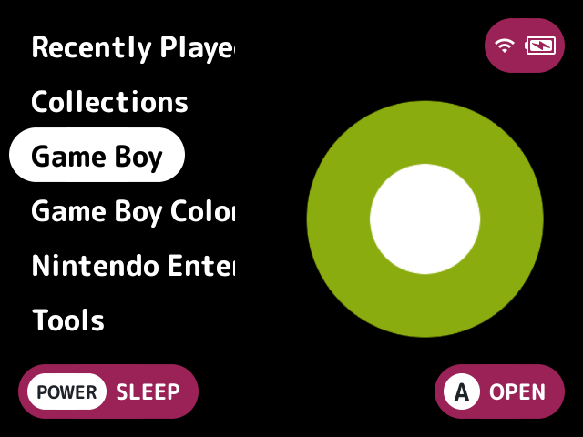

Text size set to larger.

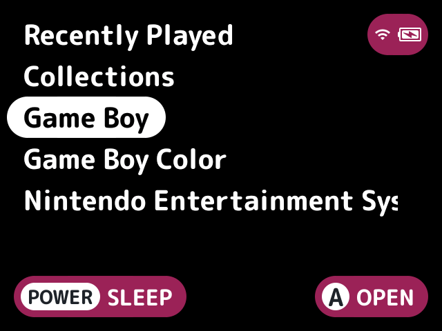

UI size set to compact.

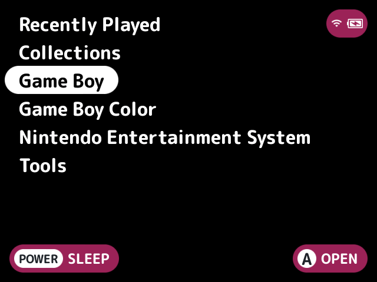

## Settings

The settings from Background colour on override the theme's values, or stock's. `theme` keeps the theme's.

| Setting | Choices | Default | What it does |
|---|---|---|---|
| Theme (`theme`) | text | stock | The theme: a folder name in Themes, a bundled theme, a palette's name, or `stock` for no change |
| Quick menu tile (`tile`) | on, off | on | A Theme tile on the quick menu that lists the themes |
| Theme button (`button`) | none, Y, L2, R2, SELECT | none | A game list button that lists the themes |
| Rotate (`rotate`) | off, start, daily | off | A random theme each time the launcher starts (`start`) or one a day (`daily`) in place of the Theme setting's |
| Rotate between (`rotate_between`) | text | empty | The themes a rotation picks from, separated by commas. Empty picks from every theme the list shows |
| Wallpaper pack (`wallpaper_pack`) | text | empty | A folder in Wallpapers with a `<system tag>.png` for each system's list, over the theme's own. Empty keeps the theme's |
| Icon pack (`icon_pack`) | text | empty | A folder in Icons with a `<system tag>.png` for each system, over the theme's own. Empty keeps the theme's |
| Background colour (`background`) | text | theme | The background colour as `0xRRGGBB` |
| Text size (`text_size`) | theme, small, stock, large, larger, largest | theme | Text size |
| Contrast (`contrast`) | theme, off, 3, 4.5, 7 | theme | The least contrast ratio text keeps |
| UI size (`ui_size`) | theme, stock, compact, large, larger | theme | UI size. It also sets the button and works out the margins |
| Screen margins (`margins`) | theme, auto, 2, 5, 8, 10, 15, 20 | theme | Screen margins |
| Fallback font (`fallback_font`) | text | empty | A font for the characters the UI font has no glyphs for, a TrueType or OpenType file on the card, relative to it or a full path. Empty keeps the theme's, or none. One that isn't a file on the card is logged and the theme's is used |

The fallback font, the theme's or the setting's, overrides stock's too, and wins over the one [`localization`](../localization/README.md) supplies. With neither, a theme's font falls back to stock's own font for the characters it lacks.

With `localization` on and a language picked, a theme whose font lacks some of the language's characters gets a toast saying so, and a note under Status on this plugin's page in Launcher > Plugins (see [localization's font check](../localization/README.md#font-check)).

## For plugin authors

- Owns the `theme` slot (`slots=theme`) and applies the theme without writing to stock's settings.
- Passes other plugins' keys (with a `.`) to `theme_value`. The bundled plugins' keys are `art-backdrop.dim`, `art-placeholder.style`, `layout-grid.columns`, `layout-grid.rows`, `layout-hero-rail.cards`, `layout-shelf.shelves`, `led-status.colour` and `ui-sounds.dir`. For a folder theme with a `sounds/` folder it adds `ui-sounds.dir`, the folder's full path, after the theme's own keys, so it wins over one `theme.txt` names. A path over the 255 bytes a key's value can be is logged and left out.
- Registers the `theme-plus.pick` action, which the `button` setting follows, and a quick menu tile. The action opens the `theme-plus.picker` screen; on a launcher without plugin screens it lists the themes with `choose`.
- Answers `art_path` for a system folder's thumbnail (`MOSAIC_ART_THUMBNAIL`) and background (`MOSAIC_ART_FOLDER_BG`), and a game's list background (`MOSAIC_ART_LIST_BG`) inside a system, from the icon or wallpaper pack and then the theme's `icons/` and `wallpapers/` folders, only when stock's own files for it are missing. It answers nothing else, so other plugins' art for games is untouched.
- Saves the theme a `start` rotation picked as `rotated` in its own settings, so the next start picks another.
- Provides the `theme-plus.setup` service (`provides=theme-plus.setup`), which [`first-run`](../first-run/README.md) sets the theme through. With no arguments it gives the Theme setting now as `theme=<id>` and, as its choices, what the Theme tile lists, Stock first, as `theme.<i>=<id>` and `theme.label.<i>=<its name, as the list shows it>` from 0, as many as fit, with `theme.count=<n>`, and `restart=0`. `theme=<id>` of one of them saves the setting and reloads the lists first, as picking it from the list does, so it shows at once; any other gives `error=theme` and saves nothing. Other keys are ignored.
- Reads `<sd>/Themes/<name>/`, `<sd>/Palettes/*.txt`, `<sd>/Wallpapers/<pack>/`, `<sd>/Icons/<pack>/`, and the stock background and icon files named above.

## Credits

Nocturne, kUI, Bramley, NextUI-CN, radther, hp7hao and Xisrith.
