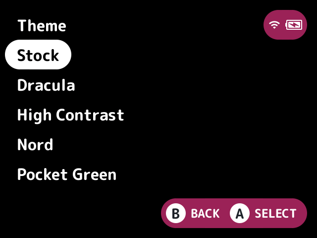
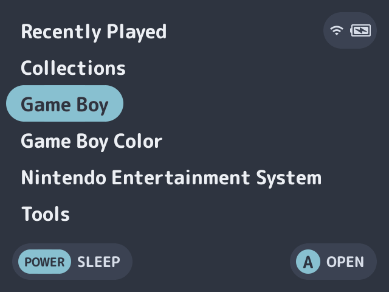
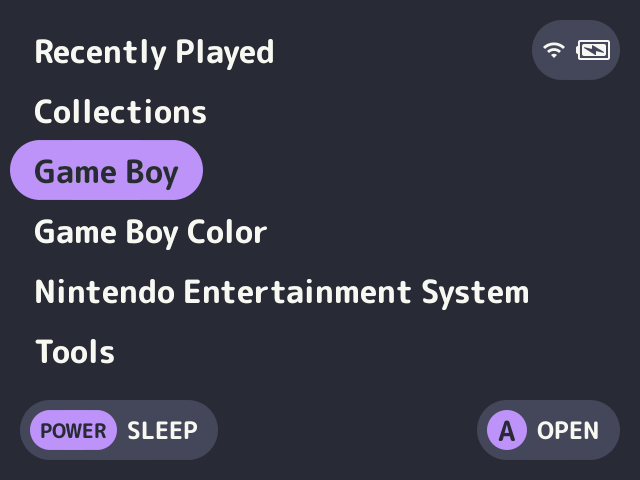
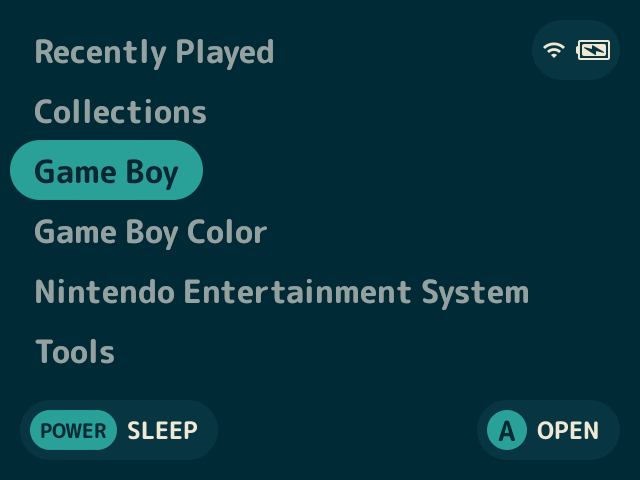
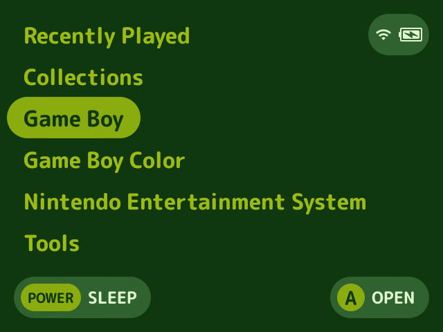
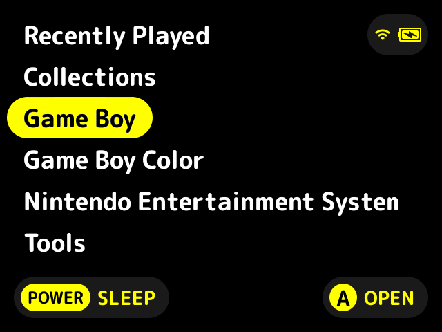
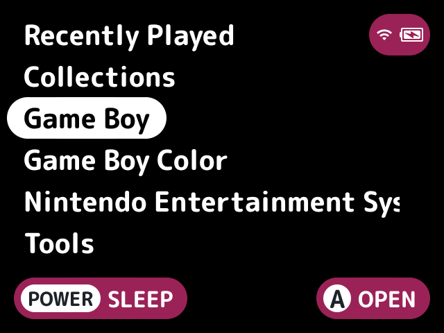
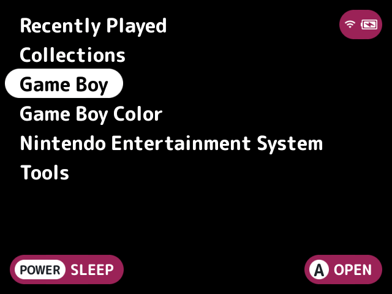

# theme-plus

Changes how the launcher looks - colours, font, text size, wallpapers and button hints - from a theme, without touching stock's settings.

A theme is a folder you can copy or share. The launcher's look changes, while stock's Settings app and other apps keep your own palette.

## Turn it on

Turn on **Theme plus** in Launcher > Plugins ([how](../../docs/plugins.md#turning-plugins-on-and-off)), then pick a theme. It owns the `theme` [slot](../../docs/glossary.md#slot).

## How to use

The Theme setting names a theme. The default, `stock`, changes nothing. A theme can be:

- A folder `<sd>/Themes/<name>/` with a `theme.txt` and, if it likes, its own font and wallpapers.
- One of the themes it ships: `nord`, `dracula`, `solarized-dark`, `pocket-green` and `high-contrast` (colours only; the last has a 7:1 contrast and larger text).
- The name of any of stock's palettes (the built-in ones and `<sd>/Palettes/*.txt`), as a colours-only theme. It shows only in the launcher while stock's Settings app and other apps keep your palette.

A name is looked for in that order, exactly and then ignoring case.

To pick one from a list, use the Theme tile on the [quick menu](../../docs/glossary.md#quick-menu) or the `theme-plus.pick` action, which the Theme button setting puts on a button. It applies the one picked at once. The list shows the themes by name, then the palettes as stock's Settings lists them, with the one you picked in Settings marked "(in Settings)". A palette with the exact name of a theme or an earlier palette isn't listed, since the name picks that one.

A wallpaper only shows where the card has no stock background (`bg.png`, `.media/bg.png`, `bglist.png` or `quick_<name>.png`), so ones placed by hand win.

## Writing a theme

`theme.txt` is lines of `key=value`. Blank lines and `#` comments are skipped.

| Key | Meaning |
|---|---|
| `version` | `1`. A theme with a newer version isn't used |
| `name` | What the list shows, else the folder's name |
| `palette` | A stock palette's name, the first with it in Settings' order, whose seven colours fill the ones the theme leaves unset. The theme's own `color1` to `color7` win |
| `color1` to `color7` | Colours in stock's palette format, `0xRRGGBB` or `0xRRGGBBAA`. `color7` is the background |
| `font` | A TrueType or OpenType file |
| `fallback_font` | A TrueType or OpenType file for the characters the UI font has no glyphs for, such as CJK game names |
| `text_step` | Points added to stock's text, -2 to 8 |
| `contrast` | The least contrast ratio text keeps, 1 to 21, such as `4.5` |
| `pill_size` | 18 to 60 |
| `button_size` | 12 to 56 |
| `padding` | The screen's margins, 1 to 30 |
| `wallpaper`, `wallpaper_list`, `wallpaper_quick` | PNGs for the background, a game folder's background and the quick menu's |
| `hint_style` | `text`, `abxy`, `cardinals` or `shapes`, as stock's Settings names them. The launcher draws button hints in it over your style, in the launcher only. Without it your style stays |

For example, one per line: `name=Night`, `palette=Catppuccin Mocha`, `color7=0x101018`, `font=night.ttf`, `text_step=2` and `wallpaper=bg.png`.

- Font, fallback font and wallpaper paths are relative to the theme's folder and must stay inside it: no absolute paths, no `..`, and no symlink that leads out.
- Any other key with a `.` in it, such as `led-status.colour=0x88C0D0`, is another plugin's. It's passed on to the launcher as it is, for that plugin to read with `theme_value` (see [plugin-api.md](../../docs/plugin-api.md) for the keys the bundled plugins read and the launcher's limits on them), and the launcher logs one it refuses.
- Other unknown keys and lines without `=` are logged and ignored. A bad value is logged and dropped, as is anything the launcher then refuses.

## Screenshots

The theme picker from the Theme tile, with the default settings.

Theme set to nord.

Theme set to dracula.

Theme set to solarized-dark.

Theme set to pocket-green.

Theme set to high-contrast.

Text size set to larger.

UI size set to compact.

## Settings

The settings other than Theme, the tile and the button override the theme's values, or stock's. `theme` keeps the theme's.

| Setting | Choices | Default | What it does |
|---|---|---|---|
| Theme (`theme`) | text | stock | The theme: a folder name in Themes, a bundled theme, a palette's name, or `stock` for no change |
| Quick menu tile (`tile`) | on, off | on | A Theme tile on the quick menu that lists the themes |
| Theme button (`button`) | none, Y, L2, R2, SELECT | none | A game list button that lists the themes |
| Background colour (`background`) | text | theme | The background colour as `0xRRGGBB` |
| Text size (`text_size`) | theme, small, stock, large, larger, largest | theme | Text size |
| Contrast (`contrast`) | theme, off, 3, 4.5, 7 | theme | The least contrast ratio text keeps |
| UI size (`ui_size`) | theme, stock, compact, large, larger | theme | UI size. It also sets the button and works out the margins |
| Screen margins (`margins`) | theme, auto, 2, 5, 8, 10, 15, 20 | theme | Screen margins |
| Fallback font (`fallback_font`) | text | empty | A font for the characters the UI font has no glyphs for, a TrueType or OpenType file on the card, relative to it or a full path. Empty keeps the theme's, or none. One that isn't a file on the card is logged and the theme's is used |

The fallback font, the theme's or the setting's, overrides stock's too, and wins over the one [`localization`](../localization/README.md) supplies. With neither, a theme's font falls back to stock's own font for the characters it lacks.

With `localization` on and a language picked, a theme whose font lacks some of the language's characters gets a toast saying so, and a note under Status on this plugin's page in Launcher > Plugins (see [localization's font check](../localization/README.md#font-check)).

## For plugin authors

- Owns the `theme` slot (`slots=theme`) and applies the theme without writing to stock's settings.
- Passes other plugins' keys (with a `.`) to `theme_value`. The bundled plugins' keys are `art-backdrop.dim`, `art-placeholder.style`, `layout-grid.columns`, `layout-grid.rows`, `layout-hero-rail.cards`, `layout-shelf.shelves` and `led-status.colour`.
- Registers the `theme-plus.pick` action, which the `button` setting follows, and a quick menu tile.
- Reads `<sd>/Themes/<name>/`, `<sd>/Palettes/*.txt`, and the stock background files named above.

## Credits

Nocturne, kUI, Bramley, NextUI-CN, radther, hp7hao and Xisrith.
