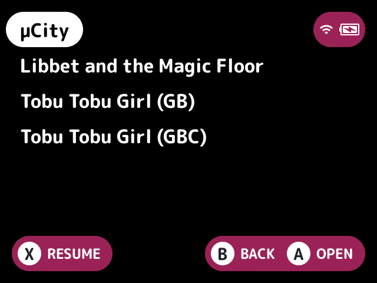

# title-disambiguation

When two titles in a list are the same, adds what tells them apart, and only then.

## What it does

- Games from different systems, as in Recently Played, [collections](../../docs/glossary.md#collection) and Favorites, get the system's tag, such as "Tetris (GB)" and "Tetris (GBC)".
- Games from one system get the region tags or extension the name leaves out, such as "Tetris (USA)" or "Tetris.gbc", then the folder they're in, and the whole file name when nothing else differs.

Unlike stock, which only marks neighbours with the same name, it finds collisions anywhere in the list.

## Turn it on

Turn on **Title disambiguation** in Launcher > Plugins ([how](../../docs/plugins.md#turning-plugins-on-and-off)).

## Screenshots

Tobu Tobu Girl from Game Boy and Game Boy Color in Favorites, with the default settings.

## Settings

| Setting | Choices | Default | What it does |
|---|---|---|---|
| Same system too (`same_system`) | on, off | on | Also tells apart same-named games from one system (by tags or extension), not only games from different systems. Off renames only games from different systems and leaves the rest to stock |

## For plugin authors

- Renames entries with `entry_set_name` from the `list_ready` hook.
- Has no slot, service or file of its own.

## Credits

Ru_UI and casualducko.
