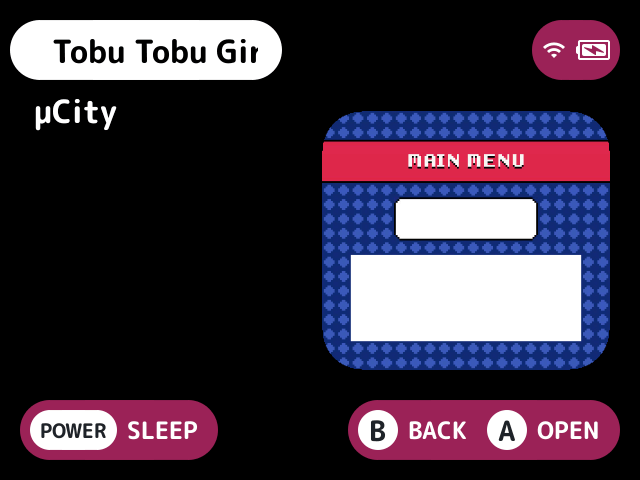

# video-previews

Plays a short clip of the selected game in place of its thumbnail.

## What it does

The clip is `<rom dir>/.videos/<rom name>.mp4`, H.264 with AAC or MP3 sound, as scrapers make them. It plays once the selection has rested on the game for the Play after seconds (after the selection settles), looping until the selection moves.

It plays on the built-in list in place of the thumbnail, or in a plugin layout's own spot for the selected game's art. The bundled layouts draw it. A layout that doesn't ask for it with `art_replacement` shows none.

- The sound plays at the system's volume, unless Sound is off. Where the audio device can't open, such as beside stock's own on a device, clips play silently.
- Off the game list, or with Show game art off, there's no thumbnail to stand in for, so nothing plays. The plugin tries again later, waiting longer each time up to 16 seconds.
- Decoding runs on a thread of the plugin's own, at most 30 frames a second. When it can't keep up it skips frames nothing refers to, so a clip gets choppy rather than slow.
- The audio device stays open on silence between clips, as closing it clicks on some devices, and closes after 5 seconds without one. Up to a quarter of a second of a clip's sound can play on after the selection moves.

### On the screensaver

With the [`screensaver`](../screensaver/README.md) plugin's Images set to `videos`, the screensaver plays the games' clips: for a game with a clip, it plays full screen, looping, until the screensaver moves on to the next image, with the screensaver's clock and what [`music`](../music/README.md) plays drawn over it. The screensaver's own buttons still work: X plays or pauses music, and any other button closes both. While a clip plays, with Sound on, music pauses, and it plays on when the screensaver moves on to an image without a clip or closes, if it was playing before and nothing played it on in between; it isn't played on after the device sleeps, as music doesn't play on after a sleep. The game list's clip stops while the screensaver's plays and plays again after the Play after delay. See the screensaver's [screenshot](../screensaver/docs/with-video-previews.png).

## Turn it on

Turn on **Video previews** in Launcher > Plugins ([how](../../docs/plugins.md#turning-plugins-on-and-off)). On a build made without ffmpeg, as CI does, or on a desktop without ffmpeg's libraries, the plugin logs that it's unavailable and plays nothing.

## Screenshots

A clip playing in place of the thumbnail, with the default settings.

## Settings

| Setting | Choices | Default | What it does |
|---|---|---|---|
| Play after, in seconds (`delay`) | 1, 2, 3, 5 | 2 | Seconds the selection rests on a game before its clip plays |
| Sound (`sound`) | on, off | on | The clip's sound, at the system's volume. On the screensaver, music pauses while a clip plays |

## For plugin authors

- Nothing is decoded until a clip is due: ffmpeg is loaded then, with `dlopen`.
- On devices that's a trimmed LGPL build of ffmpeg 6.1.2 in the plugin's own lib folder, which `make devices` builds (see [DEVELOPMENT.md](../../docs/DEVELOPMENT.md)). On desktop it loads the system's ffmpeg (Homebrew's on macOS).
- Draws through the layouts' `art_replacement` spot, and reads `<rom dir>/.videos/<rom name>.mp4`.
- Provides `video.play`, listed in its `provides=`, for the screensaver's `videos` source: `path=<game>` plays the game's clip on its own full screen, `video-previews.saver`, opened over the screensaver's in place, with no slide (`MOSAIC_SCREEN_INSTANT`), with `clock=<off, 24h or 12h>` and music's `music.now` line drawn over it, answering `playing=1`; a game without a clip, or no `path`, closes that screen and answers `playing=0`. It pauses and plays on music with `music.pause` and `music.play`.
- Where ffmpeg isn't there, it doesn't provide `video.play`, so the screensaver shows the games' art. For the tests only, `MOSAIC_VIDEO_PREVIEWS_FAKE` plays a plain grey picture in place of each of the screensaver's clips, without ffmpeg.

## Credits

NextUI-plus.
